# CampusShop - Explicación del Código

Este proyecto es una tienda web de ropa maquetada únicamente con **HTML5 y CSS3 puro** (sin JavaScript ni frameworks externos). Toda la interactividad visual funciona mediante selectores y estados de CSS.

---

## 1. Estructura de Archivos

```text
Campus-shop/
├── index.html         # Página de inicio con buscador, categorías y novedades
├── catalogo.html      # Catálogo con filtros de categorías funcionales por CSS
├── producto.html      # Detalle de una prenda con selección de talla y cantidad
├── carrito.html       # Carrito de compras con opción de eliminar prendas
├── vacio.html         # Vista cuando no hay productos en el carrito
├── checkout.html      # Formulario de datos de envío y métodos de pago
├── historial.html     # Tarjetas con el historial de pedidos realizados
├── perfil.html        # Datos del usuario y accesos rápidos
├── css/
│   ├── base.css       # Variables globales (:root) y reseteo básico
│   ├── layout.css     # Estructura del cascarón (header, main, footer nav)
│   ├── components.css # Estilos de tarjetas, botones, inputs, menú lateral
│   └── responsive.css # Media queries para adaptar la web a tablet y PC
└── img/               # Imágenes de las prendas en formato .webp
```

---

## 2. Cómo están organizados los estilos CSS

El CSS está dividido en 4 archivos para que sea modular y fácil de mantener:

### `css/base.css` (Variables y Reset)

- Define las variables de color en `:root`:
  - `--color-primario: #4f46e5` (violeta/azul principal).
  - `--color-acento: #ede9fe` (violeta claro para badges y fondos suaves).
  - `--color-fondo: #f8fafc` (color de fondo de la web).
  - `--color-tarjeta: #ffffff` (blanco para las cards).
  - `--sombra-suave` y `--sombra-elevada` (sombras tenues para dar profundidad).
- Aplica el reseteo estándar (`box-sizing: border-box`, márgenes en 0 y tipografía del sistema).

### `css/layout.css` (Estructura general)

- `.contenedor-app`: Contenedor principal de la aplicación.
- `.encabezado-superior`: Barra superior fija (`position: sticky`) con el logo y el botón del menú.
- `main`: Área de contenido central (`flex: 1; align-content: start;`).
- `.navegacion-inferior`: Menú de navegación fijo en la parte inferior (`position: fixed`).

### `css/components.css` (Componentes visuales)

- **Tarjetas de producto (`.tarjeta-producto`)**:
  - Usan `display: flex; flex-direction: column; height: 100%;`.
  - El título tiene `min-height: 2.7em` y `line-clamp: 2` para que todos los títulos ocupen el mismo espacio.
  - El precio tiene `margin-top: auto`, lo que empuja el precio y el botón "Ver detalle" al fondo, manteniéndolos siempre alineados horizontalmente sin importar el largo del texto.
- **Botones**: `.boton-primario` (fondo sólido con hover) y `.boton-lineas` (borde con fondo transparente).
- **Formularios**: `.campo-formulario` con bordes redondeados y sombra violeta al hacer foco (`:focus`).
- **Historial (`.tarjeta-pedido`)**: Tarjetas de pedidos con líneas divisorias para cabecera, prendas y total.

### `css/responsive.css` (Media Queries)

Detecta el tamaño de la pantalla mediante `@media`:

1. **Móvil (< 640px)**: 2 columnas en productos, elementos apilados y dock inferior móvil.
2. **Tablet (640px a 1023px)**:
   - Catálogo pasa a 3 columnas.
   - Categorías en fila de 4 columnas.
   - Detalle de prenda, carrito, checkout y pedidos se dividen en 2 columnas equilibradas.
3. **Computador Completo (>= 1024px)**:
   - La pantalla se abre al 100% de ancho sin marcos de celular.
   - El contenido se centra con un ancho máximo de `1280px`.
   - Catálogo a 4 columnas y pedidos en 3 columnas simétricas.

---

## 3. Trucos interactivos con Puro CSS (Sin JavaScript)

El proyecto simula interactividad utilizando pseudo-clases y selectores avanzados de CSS:

1. **Abrir y cerrar el Menú Lateral:**

   - Hay un checkbox oculto (`#interruptor-menu`).
   - Al hacer clic en el icono `☰`, el checkbox cambia a `:checked`.
   - Con `#interruptor-menu:checked ~ .menu-lateral`, el menú cambia su posición de `left: -100%` a `left: 0`.
2. **Filtros por categoría en `catalogo.html`:**

   - Se usan radio buttons ocultos (`#filtro-sudaderas`, `#filtro-camisetas`, etc.).
   - Cuando uno está `:checked`, oculta las tarjetas que no corresponden mediante `:not()`:
     ```css
     #filtro-sudaderas:checked ~ main .cuadricula-productos .tarjeta-producto:not(.prenda-sudadera) {
         display: none;
     }
     ```
   - Además, la etiqueta activa cambia su color a violeta primario.
3. **Simular eliminación de prendas en `carrito.html`:**

   - Cada producto tiene un checkbox oculto (`#eliminar-item-1`, etc.).
   - Al hacer clic en la papelera `🗑️`, se desmarca el checkbox.
   - Con `:not(:checked)`, el item se oculta con `display: none;`.
   - Si ambos se desmarcan, se oculta la lista y aparece la sección `#seccion-carrito-vacio`.
4. **Selección de talla en `producto.html`:**

   - Radio buttons ocultos (`name="talla"`) asociados a `<label class="opcion-talla">`.
   - Con `.input-talla:checked + .opcion-talla`, la talla seleccionada se pinta de color violeta con texto blanco.

---

## 4. Cómo probar el código

Solo abre cualquiera de los archivos `.html` en tu navegador:

- En VS Code, haz clic derecho en `index.html` y selecciona **Open with Live Server**.
- O haz doble clic directo sobre `index.html` para abrirlo en el navegador.


| Número | Maqueta | Resultado | Observaciones del Resultado Real (Diseño e Interfaz) |
| :---: | :---: | :---: | :--- |
| 1 | 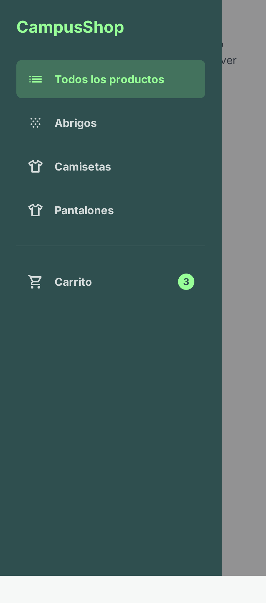 | 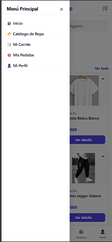 | Presenta un panel modal deslizable sobre fondo blanco con botón de cierre (`x`) en la esquina superior. Utiliza una lista vertical con íconos ilustrados a color y texto oscuro para la navegación (*Inicio*, *Catálogo de Ropa*, *Mi Carrito*, *Mis Pedidos*, *Mi Perfil*). |
| 2 | 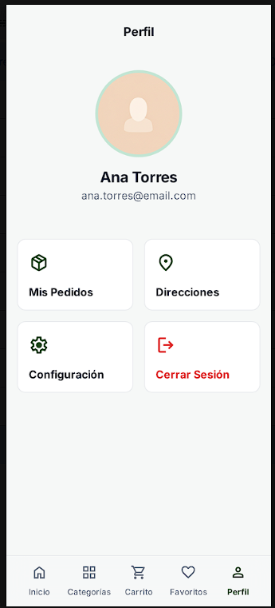 | 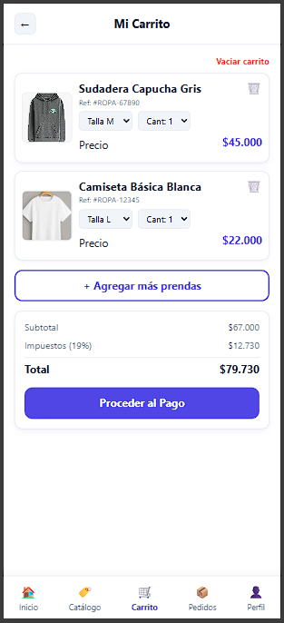 | Encabezado blanco con el logo "CampusShop" e íconos en azul rey (`#4C43EC`). Incluye barra de búsqueda gris clara, selectores de categoría tipo *pills*, tarjetas de productos en 2 columnas con precios en COP, botones azules "Ver detalle" y barra de navegación inferior fija (*Bottom Nav*). |
| 3 | 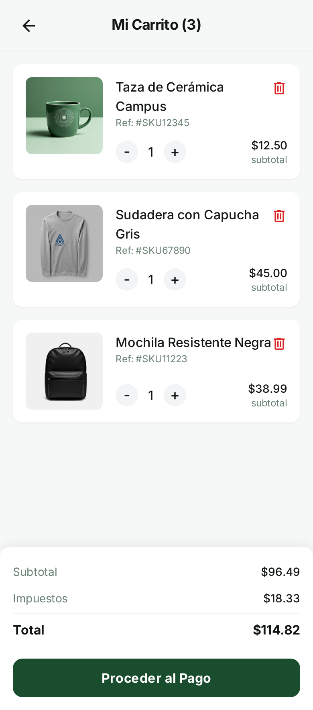 | 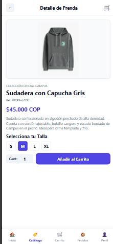 | Cabecera con título "Catálogo de Ropa", buscador superior y lista de filtros horizontales desplazables resaltando la opción activa "Todos" en azul. Tarjetas de producto con botón de favoritos (corazón), categoría superior, precio en azul y botón "Ver prenda". |
| 4 | 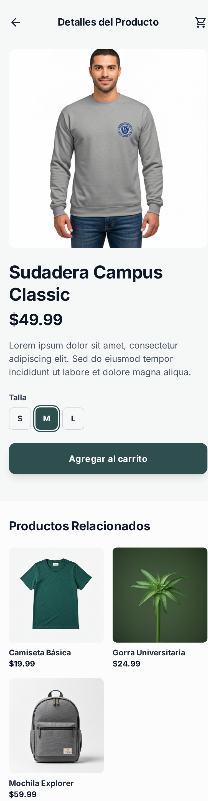 | 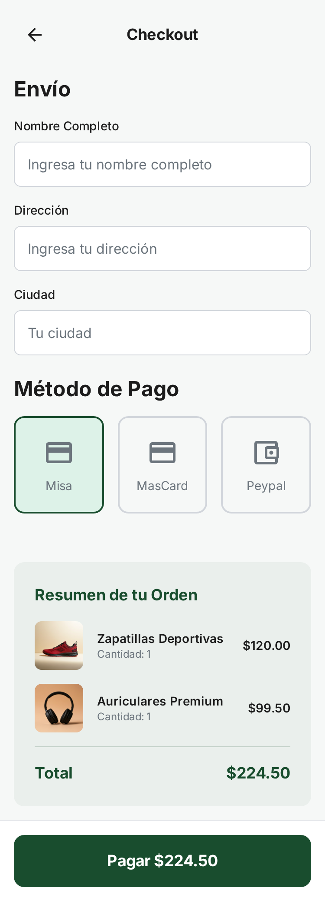 | Pantalla de estado vacío con ilustración 3D de bolsas de compras en tonos azul y naranja. Título principal "Tu carrito está vacío", texto descriptivo en tono gris secundario y botón de acción principal (*CTA*) "Explorar Catálogo de Ropa" en azul rey. |
| 5 | 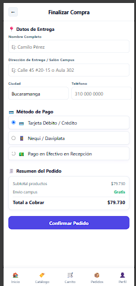 | 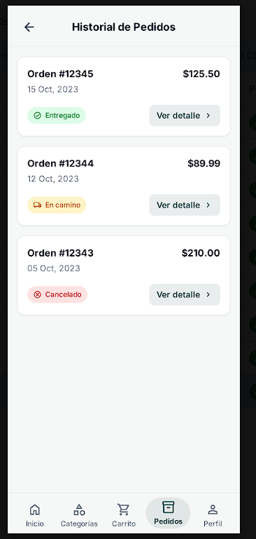 | Contenedor de imagen de producto con bordes redondeados. Incluye título de la prenda, código de referencia (`#ROPA-67890`), precio destacado en azul rey (`$45.000 COP`), bloque descriptivo, botones cuadrados para seleccionar talla, selector de cantidad (`Cant: 1`) y botón "Añadir al Carrito". |
| 6 | 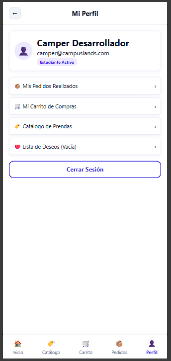 | 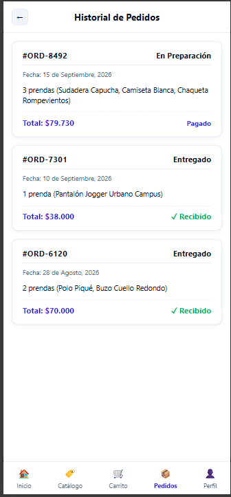 | Tarjetas de producto individuales con controles desplegables (*dropdowns*) para `Talla` y `Cant`, ícono de papelera y precio en azul. Incluye opción superior "Vaciar carrito" en texto rojo, botón de borde azul `+ Agregar más prendas`, bloque de desglose (Subtotal, Impuestos 19%, Total) y botón "Proceder al Pago". |
| 7 | 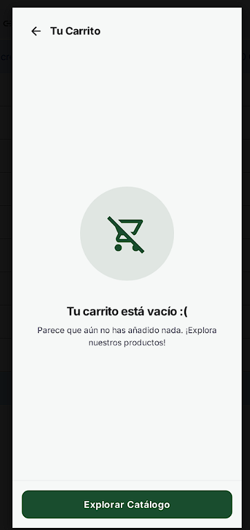 | 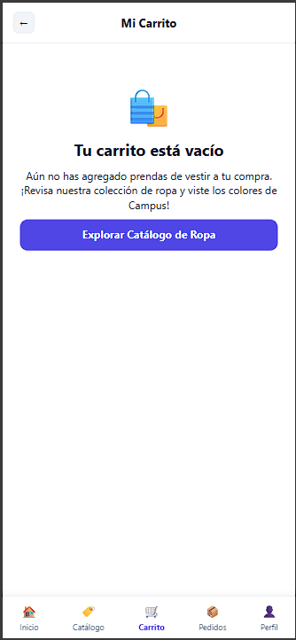 | Formulario organizado en 3 bloques independientes con íconos identificadores:<br>• **Datos de Entrega:** Campos para *Nombre*, *Dirección/Salón*, *Ciudad* y *Teléfono* con textos de ejemplo.<br>• **Método de Pago:** Lista vertical con opciones (*Tarjeta*, *Nequi/Daviplata*, *Efectivo*) seleccionables mediante *radio buttons*.<br>• **Resumen del Pedido:** Desglose financiero resaltando "Envío campus: Gratis" y botón azul "Confirmar Pedido". |
| 8 | 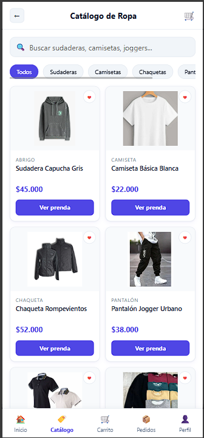 | 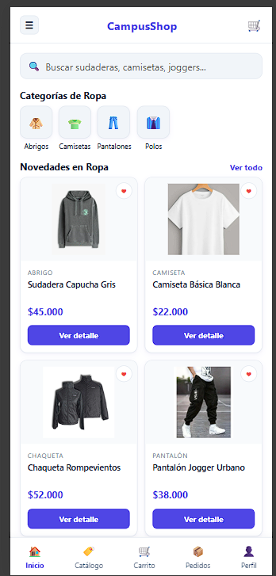 | Tarjetas de órdenes identificadas por código (`#ORD-XXXX`) con indicación de estado en la parte superior ("En Preparación", "Entregado"). Detalla fecha de compra, resumen de prendas incluidas, total pagado en azul y marcas de confirmación en verde ("Pagado", "✓ Recibido"). |
| 9 | 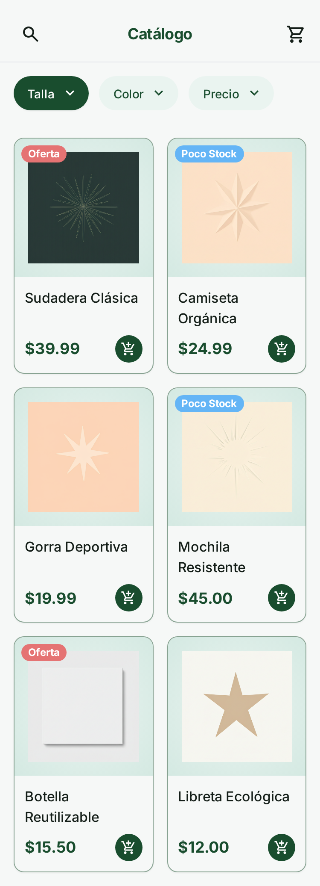 | 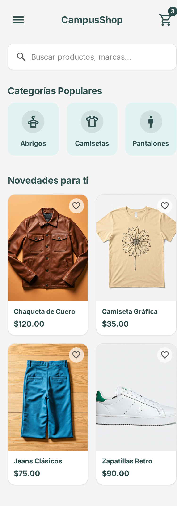 | Encabezado de usuario con ícono de avatar, correo institucional y la etiqueta "Estudiante Activo". Menú de opciones organizado en contenedores individuales de bordes redondeados con flechas indicadoras (`>`), cerrando con un botón de contorno azul para "Cerrar Sesión". |
